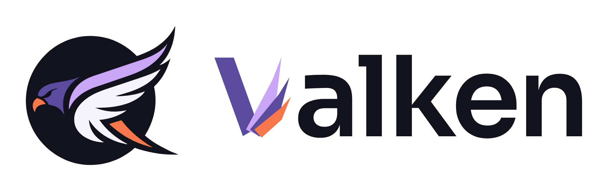

<p align="center">
  <a href="https://valken.io"></a>
</p>

<h1 align="center">valken-core</h1>

<p align="center">
  The Kubernetes connectivity library behind <a href="https://valken.io">Valken</a>.
</p>

[Valken](https://valken.io) is a desktop app for people who run
Kubernetes. It turns your cluster into a live map of what's running, what's talking and what's exposed, 
with an agent on your own model that investigates and shows its answer visually.
Valken visualises ingress traffic, events and config changes, and a security lens over
network policies, images and credentials — so you can see a problem and
act on it from one place.

`valken-core` is the part that talks to the cluster. It is plain Rust
(kube 3, tokio), reads through a handful of traits so every pipeline can be
driven in tests without a cluster, and only ever *writes* through one
module (`k8s::write`, server-side dry run first). Three Godot nodes behind
the `godot` feature connect it to the app.

## What's in it

| Module | Does |
|---|---|
| `k8s::kubeconfig` | Finds and merges kubeconfigs like kubectl, watches them, probes a context before connecting. |
| `k8s::KubeWatcher` | Connects and streams `Watched` events: a full snapshot, then every Pod / Deployment / Service / Ingress / Namespace change. |
| `k8s::ResourceIngest` | Folds those events into a store and a relationship graph. |
| `k8s::table`, `k8s::objects`, `k8s::events`, `k8s::rollout`, `k8s::configs` | Live `kubectl get` tables, one-off reads, events, rollout history, ConfigMap / Secret *metadata*. |
| `k8s::security` | Read-only inventory for the security lens, with redacted exports. |
| `k8s::metrics`, `traffic` | Cluster / pod metrics; ingress access-log tailing. |
| `k8s::write` | The only code that changes a cluster. |

Secret values, env values and credential-plugin environments never leave
the cluster or reach a log — see [SECURITY.md](SECURITY.md) for the
promise and `CONTRIBUTING.md` for how to keep it.

## Use it

```toml
[dependencies]
valken-core = { git = "https://github.com/valkenhq/valken-core", default-features = false }
```

Connect to the current context and receive events:

```rust
use valken_core::k8s::{KubeWatcher, Watched};

let (tx, rx) = crossbeam_channel::unbounded();
let watcher = KubeWatcher::new(tx);
watcher.connect().await?;        // the kubeconfig's current context
watcher.begin_watching().await?; // returns once the first full snapshot is sent

for event in rx {
    match event {
        Watched::FullResourceList(list) => println!("{} resources", list.resources.len()),
        Watched::Pod(pod) => println!("pod {:?}", pod.metadata.name),
        _ => {}
    }
}
```

Or let the user pick a context: `kubeconfig::discover` lists them,
`Discovery::client_config` builds a `Config` for one, and
`KubeWatcher::connect_context` connects with progress callbacks.

Leave the `godot` feature on (the default) to get `KubeStore`,
`AsyncRuntime` and `AsyncNotifier` for a Godot project.

## Build and test

```sh
make test-core   # engine-free tests — fast, no cluster needed
make ci          # what CI runs: fmt, clippy (both feature sets), tests, docs
```

The integration tests in `tests/` run the watcher, ingest and traffic
pipelines over in-memory fakes. The `*_live.rs` tests are `#[ignore]`d and
only run against a cluster you point them at:

```sh
VALKEN_TEST_KUBECONFIG=~/.kube/kind.yaml cargo test -- --ignored
```

They never read `KUBECONFIG` or `~/.kube/config`, and every write they make
is a server-side dry run.

## Contributing and releases

See [CONTRIBUTING.md](CONTRIBUTING.md). Every PR bumps the version
(`make bump-patch` / `bump-minor` / `bump-major`); merging tags and
releases it. [CHANGELOG.md](CHANGELOG.md) has what changed.

Licensed under [Apache-2.0](LICENSE).
